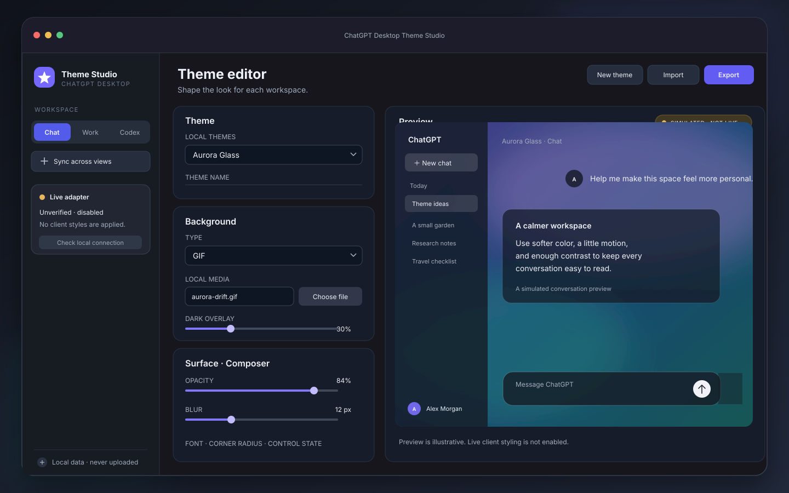

# ChatGPT Desktop Theme Studio

> An independent community project. Not affiliated with or endorsed by OpenAI.

[](https://github.com/alvinczq7-cell/chatgpt-desktop-theme-studio/actions/workflows/ci.yml)
[](https://github.com/alvinczq7-cell/chatgpt-desktop-theme-studio/releases)
[](LICENSE)

A Windows companion app for designing and organizing local themes for the new ChatGPT desktop app. Theme editing covers the Chat, Work, and Codex views; live application to the official client is still under compatibility validation.

[English](README.md) · [简体中文](README.zh-CN.md)


Want to try the moving background? Download [Aurora Motion](samples/packages/aurora-motion-1.0.0.tstheme) and import it in Theme Studio.



## Current status

**The theme manager has passed a local Release build, 13 automated tests, package generation, installer build/install, and a 10-second launch check from both the portable and installed folders. The live ChatGPT adapter remains unverified and disabled.** The manager supports a local theme library, package import/export, simulated preview, and animated backgrounds; it does not yet claim to apply themes live to ChatGPT.

The target is Windows 11 x64 with .NET 10 and Windows App SDK. Download the [latest preview release](https://github.com/alvinczq7-cell/chatgpt-desktop-theme-studio/releases/latest). See the [progress checkpoint](docs/progress-2026-10-10.md) for the exact status.

## MVP features

- Separate appearance profiles for Chat, Work, and Codex.
- Background fit and position controls with local image, GIF, MP4, and WebM media.
- Per-surface color, opacity, blur, font, radius, and control-state settings.
- Silent looping with manual pause and power/accessibility pause rules.
- Local theme packages with media included; no scripts or arbitrary CSS.
- Simulated previews for comparing theme settings before export.
- A fail-closed client adapter: its local probe counts renderer pages without reading their URLs, and stays disabled until a ChatGPT build is verified.

If this project is useful to you, a GitHub star helps other ChatGPT Desktop users find it. [Report a bug](https://github.com/alvinczq7-cell/chatgpt-desktop-theme-studio/issues/new?template=bug_report.yml), [share a compatibility result](https://github.com/alvinczq7-cell/chatgpt-desktop-theme-studio/issues/new?template=compatibility_report.yml), or [request a feature](https://github.com/alvinczq7-cell/chatgpt-desktop-theme-studio/issues/new?template=feature_request.yml). Please keep chat content, account data, private media, and personal file paths out of public reports.

## Build

Open `ThemeStudio.sln` with Visual Studio 2026 or a .NET 10 SDK installation that includes the Windows App SDK workload/components. The solution is unpackaged.

```powershell
dotnet build ThemeStudio.sln -c Release -p:Platform=x64
dotnet test tests/ThemeStudio.Tests/ThemeStudio.Tests.csproj -c Release -p:Platform=x64
```

The release workflow creates a portable folder ZIP, an Inno Setup installer, sample themes, and SHA-256 checksums. The installer is currently unsigned. Live theme injection and safe launch remain disabled until the adapter passes version-specific validation.

## Theme package

Theme files are ZIP containers with `manifest.json`, `theme.json`, and an optional `assets/` directory. Only declared image/video media is accepted. Import validates paths and media extensions before extracting. The package format is versioned; see `docs/theme-package-v1.md`.

## Compatibility and safety

- Windows 11 x64 and the new ChatGPT desktop app are the initial targets.
- ChatGPT Classic, browser clients, Windows 10, ARM64, and macOS are out of scope for the first release.
- The live adapter is deliberately fail-closed: it will not inject styles until a version-specific compatibility mapping is tested and enabled.
- No conversation content is read or uploaded. The planned CDP connection is loopback-only; CDP is a privileged debugging interface, so it must not be exposed to the network.
- The companion does not modify files in the official app package.

## License

Application code is MIT licensed. Theme media remains subject to its author's license and must not be redistributed without permission.
